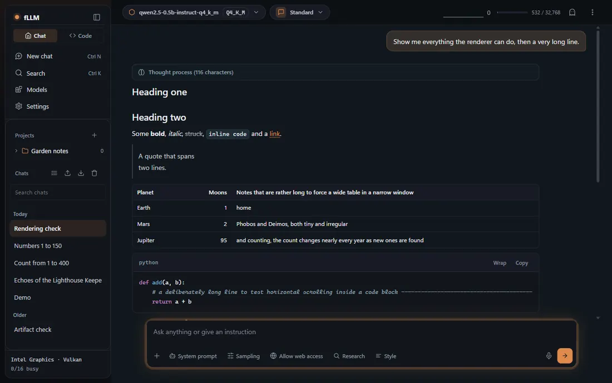

# fLLM

fLLM is an LLM inference engine written in Rust, with a desktop app (chat, coding agent and model manager)
on top. It runs models **as they are published**: GGUF files (all 35 ggml storage types it registers, including the K
and IQ quants) and Hugging Face checkpoints in safetensors or PyTorch form load directly, with no conversion step and
no GGUF file written, and quantized weights **stay quantized**: AWQ and GPTQ 4-bit (act-order included), FP8 (per-tensor
and block-wise), NVFP4, MXFP4, bitsandbytes NF4 / FP4 / int8, MLX affine (2 to 8 bits), EXL2 and EXL3 are computed in
their packed form by native kernels wherever a backend has one (the tables below say where; nothing is expanded to
16 bits unless a table says so). It quantizes, and serves OpenAI, Anthropic, Ollama, SGLang, TGI and llama.cpp style HTTP
APIs from one port. Backends: the CPU (AVX2, AVX-512, NEON), CUDA, native Vulkan, Metal, ROCm/HIP, OpenGL and wgpu
(Vulkan, Metal, DirectX 12), plus SYCL, Intel NPU and TPU paths in various states. It also has a terminal chat
(`fllm-rs run`), a headless coding agent and a Telegram / Matrix gateway, encoder and embedding models, and image input
(SigLIP/Idefics3 projectors, Qwen-VL).

The Rust workspace (`rust/engine`, `rust/checkpoint`, `rust/gguf-probe`) has no llama.cpp or GGML
dependency. The only non-Rust sources are the GPU kernels (CUDA, HIP, Metal, SYCL, shaders), which are
compiled only when the matching Cargo feature is on; a few CUDA parts are adapted from vLLM (Marlin),
CUTLASS and FlashInfer, see [THIRD_PARTY.md](THIRD_PARTY.md). The binary does not need Python.

fLLM is young. Read [Status](#status) for what has actually run on which hardware.

## Quick start

**1. Desktop app** (Windows and Linux): download the installer from the
[latest release](https://github.com/Marco-Lu2508/fLLM/releases) (`fLLM_<version>_x64-setup.exe` or `.msi` on Windows;
`.deb`, `.rpm` or `.AppImage` on Linux), install it and start it. On the first start the app shows your hardware and
suggests models that fit into its memory; pick one and chat. No terminal needed. The installers are not signed yet,
so Windows may show a warning ([docs/user/desktop.md](docs/user/desktop.md)). macOS is not packaged yet.

**2. Release binary** (command line; Linux x86_64/aarch64, macOS aarch64/x86_64, Windows x86_64):

```sh
git clone https://github.com/Marco-Lu2508/fLLM && cd fLLM
curl -fsSL https://raw.githubusercontent.com/Marco-Lu2508/fLLM/main/install.sh | sh        # Linux, macOS -> ~/.local/bin/fllm-rs
./run.sh run unsloth/Qwen3.5-9B-GGUF:Q4_K_M           # downloads the model once, then chats in the terminal
```

Each release has archives for Linux (musl and gnu, x86_64 and aarch64), macOS (aarch64 and x86_64) and Windows
(`fllm-windows-x86_64-msvc.zip`), each with a `.sha256` file; 0.x releases are marked as pre-releases. The archives
are built with the `rust-gpu` feature (CPU, Vulkan, Metal, DirectX 12 through wgpu); the Linux `gnu` and desktop
builds also contain the native Vulkan backend. CUDA and ROCm archives are optional release assets, listed on the
release page when their build succeeded; otherwise use the CUDA image or build with `--features cuda`.

**3. Docker** (images on ghcr.io: `latest` for CPU, linux/amd64 and linux/arm64; `cuda` for linux/amd64):

```sh
docker run -it --rm -v fllm:/home/fllm/.cache ghcr.io/marco-lu2508/fllm:latest run unsloth/Qwen3.5-0.8B-GGUF:Q4_K_M
docker run -it --rm --gpus all -v fllm:/home/fllm/.cache ghcr.io/marco-lu2508/fllm:cuda run unsloth/Qwen3.5-9B-GGUF:Q4_K_M --device cuda
docker run -d --gpus all -v fllm:/home/fllm/.cache -p 8000:8000 ghcr.io/marco-lu2508/fllm:cuda \
    serve --model unsloth/Qwen3.5-9B-GGUF:Q4_K_M --device cuda --host 0.0.0.0 --port 8000
```

The CUDA image needs only the NVIDIA driver (and the NVIDIA Container Toolkit on Linux), see
[docs/quickstart-windows-linux.md](docs/quickstart-windows-linux.md) and [docs/docker.md](docs/docker.md).

**4. From source** (Rust stable, a C compiler, Git; CUDA builds also need the CUDA toolkit):

```sh
cargo build --release --locked -p fllm-engine --features rust-gpu --bin fllm-rs
target/release/fllm-rs run unsloth/Qwen3.5-9B-GGUF:Q4_K_M
```

`run` takes a Hugging Face link (`https://huggingface.co/owner/repo`, `hf.co/owner/repo:Q4_K_M`),
`owner/repo[:QUANT]`, `hf://owner/repo[:QUANT]`, a catalog name such as `qwen3.5:9b` (`fllm-rs search`
lists them) or a local `.gguf`. It starts a server on a free local port, opens a chat and stops the
server when you quit with Ctrl-D. Extra options go to `serve`, for example `--ctx 8192 --device cpu`.
A repository with several GGUF files needs the `:QUANT` suffix.

## What it can do

### Models and formats

`serve` and `run` load **GGUF** files directly. A **checkpoint** (safetensors or PyTorch) needs no manual step either: a local
directory or file, or a Hugging Face repository with safetensors or PyTorch weights, is read into the GGUF tensor layout in
memory while it loads, with no GGUF file written, and its quantized weights keep their packed form (`--no-direct-load` or
`FLLM_NO_DIRECT_LOAD=1` converts to a cached GGUF instead; `fllm-rs convert` writes a file you name). A repository without GGUF
files is downloaded, its architecture is checked from `config.json` first, and an unknown `model_type` is refused. The
cache is `FLLM_CACHE`, else `$HF_HOME/hub`; `fllm-rs list` and `fllm-rs rm owner/repo` manage it, also the GGUF files that
`--no-direct-load` made.

What was verified: the loading of every format below with tiny synthetic checkpoints on the CPU against a dequantized reference
([docs/rust-formats-and-import.md](docs/rust-formats-and-import.md)), and the native kernels of every weight format on real
GPUs with `fllm-rs selftest-gpu` (group `linear`, against the CPU reference): CUDA on an RTX 2000 Ada, an L4 and a T4, native
Vulkan on a Radeon 840M and on the RTX 2000 Ada, ROCm/HIP on the Radeon 840M. Real multi-GB checkpoints in the packed
formats were **not** run end to end; models in the usual GGUF quantizations were (see [Status](#status)).

| Input | How it is handled | Notes |
| --- | --- | --- |
| GGUF v2/v3 with F32/F16/BF16, Q4_0 ... Q8_0, Q2_K ... Q6_K, IQ1 ... IQ4, TQ, MXFP4, NVFP4 | loaded directly | `fllm-rs formats` lists the 35 registered types; registration is not a promise of a fast kernel |
| safetensors (single or sharded) and PyTorch `.bin` / `.pt` / `.pth` | checkpoints of unquantized, AWQ, GPTQ, FP8, NVFP4, compressed-tensors, MXFP4, bitsandbytes, MLX, EXL2 and EXL3 weights, in safetensors or PyTorch ZIP files, are loaded directly by `run` / `serve` (no GGUF file; `--no-direct-load` converts instead; proven on tiny synthetic models and by the GPU self tests, not on large real checkpoints); `convert` writes a file you name | Hub repository, local directory or file; `config.json` and `tokenizer.json` are required. Unquantized bf16/f16/f32 stay as they are (`--outtype f16`/`f32` to change) or are re-encoded with `--quant q4_k_m`, `q8_0`, ... |
| bitsandbytes 4-bit (NF4, FP4, double quantization) and LLM.int8() | loaded directly (or converted); the packed codes stay 4-bit / 8-bit as fLLM-specific `NF4B64/128`, `FP4B64/128` and `INT8R` tensors, nothing is expanded when the rows are a multiple of 64 values | CPU kernels (AVX2 and portable) are tested; the CUDA kernels pass the `linear` self test on an RTX 2000 Ada, an L4 and a T4; the native Vulkan shaders read them in place and pass it on a Radeon 840M and an RTX 2000 Ada (`FLLM_VULKAN_NO_EXT_FORMATS=1` expands them), ROCm/HIP on the Radeon 840M; native Metal kernels are written (NF4 / FP4 / INT8R, checked as C++ on the CPU, awaiting the Apple-silicon run; `FLLM_METAL_NO_BNB=1` switches them off); wgpu decodes them in its shaders (checked on software Vulkan and OpenGL only) ([docs/rust-formats-and-import.md](docs/rust-formats-and-import.md)) |
| Intel AutoRound exports (`auto_round:auto_gptq`, `auto_round:auto_awq`), symmetric AWQ, Hugging Face BitNet packed ternary weights | read as GPTQ / AWQ; BitNet is expanded to F16 | the AutoRound tensor layout was checked on real repositories' headers only; BitNet packed matches transformers on a tiny checkpoint |
| AWQ 4-bit (AutoAWQ GEMM) and GPTQ 4-bit, including act-order | loaded directly, kept 4-bit as fLLM-specific `Q4Z` / `Q4ZP` tensors; nothing is re-quantized | group sizes 32, 64, 128; other sizes, fp32 scales and stacked experts are expanded to F16 |
| MLX affine quantization (mlx-community and mlx-lm exports: 2, 3, 4, 5, 6 and 8 bits, `quantization` in `config.json`), embeddings and head included | loaded directly (or converted), kept packed as fLLM-specific `MLXA` tensors: the MLX words, scales and biases as they are (4.5 bits per weight for 4-bit with group 64, like the checkpoint); nothing is re-quantized | groups that are a multiple of 32 (any size up to 8160), scales and biases exact in f16 or bfloat16 (the usual case); 7-bit weights, other group sizes and float32 scales without an exact 16-bit form are expanded to F16 with a warning; the `mxfp4` / `nvfp4` modes of MLX and stacked experts are refused |
| FP8 checkpoints (`quant_method` fp8, ModelOpt FP8, compressed-tensors float) | loaded directly and kept 8-bit: per-tensor or per-row scales as `FP8M` (f16 scale per row), block-wise `weight_scale_inv` (DeepSeek-V3, Qwen3-FP8, GLM-FP8: 128 x 128 tiles, any other power-of-two tile, f32 / bf16 / f16 / UE8M0 scales, experts included) as fLLM-specific `FP8B` tensors: the E4M3 codes as they are plus one f32 scale per tile, 1.0002 bytes per weight | the CPU multiplies `FP8B` natively (AVX2+FMA / NEON / portable, tests pass); NVIDIA GPUs from sm_60 read it in place (FP32 dequantizing GEMV for decode, FP16 tensor cores for prompts from sm_75, FP8 tensor cores for prompts from sm_89; the kernels pass the `fp8blk` self test on an RTX 2000 Ada, an L4 and a T4 (the FP8 tensor-core cases from sm_89), none of it measured on a real FP8 checkpoint); native Metal kernels are written (every power-of-two tile, f32 tile scales read in place; checked as C++ on the CPU, awaiting the Apple-silicon run; `FLLM_METAL_NO_FP8B=1` switches them off); the native Vulkan backend reads `FP8B` and `FP8M` in place (f32 shaders, the scale of a tile repeated per row: 1.03 bytes per weight; passes the self test on a Radeon 840M and an RTX 2000 Ada; rows that are not a multiple of 8 columns expand to F16); AMD HIP reads it too (Radeon 840M); wgpu decodes it in its shaders (software Vulkan and OpenGL only); SYCL and TPU expand `FP8B` to F16 at upload (2 bytes per weight) with a notice; tile shapes that are not powers of two, a row permutation that cuts through tile rows and the direct load of the codes (they are built in memory, not mapped) are the limits; no tensor-parallel splitting ([docs/rust-formats-and-import.md](docs/rust-formats-and-import.md)) |
| NVIDIA ModelOpt NVFP4 (`quant_algo` NVFP4, `hf_quant_config.json` or `quantization_config`) | loaded directly as GGUF type 40 (the layout of llama.cpp, no llama.cpp needed): block scales copied, `weight_scale_2` stored as `<name>.scale` | dense models; excluded modules (for example `lm_head`) stay bf16/f16; FP8 KV-cache scales are ignored; NVFP4 mixture-of-experts checkpoints are expanded to F16 |
| compressed-tensors int4 / int8 (`pack-quantized`, `int-quantized`, symmetric) | loaded directly: int4 groups of 32/64/128 become `Q4Z`, int8 becomes `Q8_0` | asymmetric, act-order, other bit widths, sparse and compressed-tensors NVFP4 are refused with a message |
| gpt-oss MXFP4 | repacks the MXFP4 blocks (loaded directly, or written by `convert`) | |
| EXL2 / EXL3 | stays packed: the codes, scales, group widths and permutation (EXL2) or trellis tiles and Hadamard signs (EXL3) are kept in fLLM's `EXL2` / `EXL3` GGUF types, loaded directly or written by `convert`; `--dtype f16` expands | runs natively on the CPU, on NVIDIA GPUs (CUDA-core kernels; the `linear` self test passes on an RTX 2000 Ada, an L4 and a T4), with native Vulkan (Radeon 840M, RTX 2000 Ada; `FLLM_VULKAN_NO_EXT_FORMATS=1` expands them) and with HIP; wgpu decodes both in its shaders (software Vulkan and OpenGL only); Metal has EXL2 kernels (written, checked as C++ on the CPU, awaiting the Apple-silicon run; `FLLM_METAL_NO_EXL=1` switches them off; EXL2 groups that are not a multiple of 8 inputs are expanded); EXL3 on Metal and the remaining backends expand to F16 at upload; stacked MoE experts and fractional EXL3 are expanded or refused ([docs/exl-formats.md](docs/exl-formats.md)) |

Where the weight formats run natively ([docs/gpu-backends.md](docs/gpu-backends.md),
[docs/backends.md](docs/backends.md), [docs/cpu-kernels.md](docs/cpu-kernels.md)):

| Device | Native kernels | Everything else |
| --- | --- | --- |
| CPU (x86-64, AArch64) | F32/F16/BF16, Q4_0 ... Q8_0, Q4_K ... Q6_K; on x86-64 also Q2_K, Q3_K, IQ4_NL, IQ4_XS, MXFP4; MLX affine `MLXA` (all widths and groups, f32 activations, AVX2 where present) | rows decoded on demand (functional, slow): the other IQ/TQ types, NVFP4, Q4Z/Q4ZP |
| CUDA | all of the above, the IQ family, MXFP4, NVFP4 (FP4 tensor cores on Blackwell sm_12x, Marlin FP4 on other GPUs from Turing), AWQ/GPTQ `Q4Z`/`Q4ZP` through Marlin (Turing and newer, shapes in multiples of 128), block-wise FP8 `FP8B`, bitsandbytes, EXL2 / EXL3, MLX affine `MLXA` (own kernels on the packed words; the self tests pass on an RTX 2000 Ada and an L4, the formats of `linear` also on a T4) | expanded at upload |
| wgpu (Vulkan, Metal, DX12, OpenGL) | F32/F16/BF16, Q4_0 ... Q8_0, Q4_K, Q5_K, Q6_K; decoded in the shaders: block-wise FP8 `FP8B` / `FP8M`, bitsandbytes, MLX affine, EXL2, EXL3 (the self tests pass on software Vulkan and OpenGL against the CPU; not tried on a GPU) | expanded to F32 at upload |
| Vulkan (native) | the planar formats of [docs/gpu-backends.md](docs/gpu-backends.md), plus MLX affine `MLXA` (2 to 8 bits, every group), block-wise FP8 `FP8B` / `FP8M`, bitsandbytes `NF4B64/128` `FP4B64/128` `INT8R`, EXL2 and EXL3 (the self test of every shader passes on a Radeon 840M (Mesa RADV) and on an RTX 2000 Ada (NVIDIA driver); escape hatch `FLLM_VULKAN_NO_EXT_FORMATS=1`) | expanded at upload (shapes without a kernel included) |
| Metal (native) | the formats of the table in [docs/gpu-backends.md](docs/gpu-backends.md), MLX affine `MLXA`, block-wise FP8 `FP8B` (all tile shapes), bitsandbytes `NF4B64/128` `FP4B64/128` `INT8R`, EXL2 (kernels written, checked as C++ on the CPU, awaiting the Apple-silicon run; escape hatches `FLLM_METAL_NO_MLX` / `_NO_FP8B` / `_NO_BNB` / `_NO_EXL`) | expanded at upload (EXL3 and EXL2 with groups that are not a multiple of 8 inputs included) |

### Architectures

Dense decoders (Llama, Mistral, Qwen2/3, Gemma 1-3, OLMo, Phi, Cohere, StarCoder2, GPT-NeoX, Falcon,
GLM, InternLM, Nemotron and more), mixture-of-experts (Mixtral, Qwen MoE, DeepSeek V2/V3 and Kimi K2
with multi-head latent attention, gpt-oss, Llama 4, DBRX, PhiMoE and more), and recurrent or hybrid
models (Mamba 1/2, Qwen3-Next, Qwen3.5/3.6 with gated DeltaNet in HF and llama.cpp GGUF layouts,
Nemotron-H, Granite hybrid, LFM2, Kimi-Linear). Added in the 2026-10-30 audit: Ministral (8B), Helium, BitNet b1.58 (also the
packed Hugging Face checkpoints), DeepSeek-V3.2 and GLM-5 (with dense attention instead of the sparse indexer, exact up to 2048 tokens of
context), Step-3.5/3.7 text models, and a verified MiMo-V2-Flash and Kimi-Linear. BERT, RoBERTa/XLM-R and ModernBERT serve
embeddings and rerank/classify (also BGE-M3, ColBERT, Qwen3-Embedding, EmbeddingGemma).
The full list, with the families that are **not** supported (for example DeepSeek V4, Kimi K3, Ling-3.0, RWKV), is in
[docs/architectures.md](docs/architectures.md); the per-architecture table with devices and verification levels is
[docs/model-coverage.md](docs/model-coverage.md). Conversion refuses an unknown `model_type`.

"Verified" in these tables means: a tiny random checkpoint of the architecture gives the same logits as
`transformers`. Most real checkpoints were not available for testing. The coverage against the open
models shown on artificialanalysis.ai (2026-10-13 snapshot, statuses updated 2026-10-30: 43 models, 28 verified, 2 partly, 13 not
supported) is in the same file; the checklist against vLLM and SGLang
architecture names is in [docs/model-coverage-vllm.md](docs/model-coverage-vllm.md).

Image and video input: Qwen2-VL, Qwen2.5-VL and Qwen3-VL run their vision tower in Rust (checked against `transformers` on tiny
random checkpoints, see [docs/vision-audio.md](docs/vision-audio.md)), and `--mmproj` loads a SigLIP/Idefics3 projector (SmolVLM). Other vision families, audio and
speech are not supported; for multimodal checkpoints only the text model is converted.

### Run and serve

| Command | Purpose |
| --- | --- |
| `run MODEL` | download if needed, serve on a free port, chat in the terminal |
| `serve --model MODEL` | HTTP server (the word `serve` is optional) |
| `pull`, `list`, `rm`, `ps`, `show`, `search` | model cache and catalog: download, list, remove, running servers, details, catalog names |
| `chat`, `bench`, `bench-report`, `ppl` | terminal client for a running server, load benchmark and comparison, perplexity |
| `convert`, `quantize`, `inspect`, `formats` | checkpoint to GGUF, quantizer, file inspection, type list |
| `merge-lora`, `gguf-set`, `gguf-split`, `gguf-merge` | LoRA merge, GGUF metadata and shard tools |
| `devices`, `selftest-cpu`, `selftest-gpu`, `completions` | device inventory, kernel self tests, shell completion |
| `studio` | start the server and open the Studio (the browser app) |
| `amd-npu status\|list\|pull\|serve\|build-shim\|native-bench` | the NPU of an AMD Ryzen AI processor: through FastFlowLM, or with fLLM's own kernels (`build-shim` builds the helper library over XRT, `native-bench` times a projection on the NPU against the processor) ([docs/user/amd-npu.md](docs/user/amd-npu.md), [docs/npu-xdna.md](docs/npu-xdna.md)) |
| `agent -p "TASK"`, `gateway telegram\|matrix` | the coding agent without a browser, and the same agent behind a Telegram or Matrix chat ([docs/user/agent-cli.md](docs/user/agent-cli.md)) |

`fllm-rs <command> --help` prints the usage of each command; [docs/user/commands.md](docs/user/commands.md)
and [docs/configuration.md](docs/configuration.md) cover every flag and environment variable.
The server listens on `127.0.0.1:8000` by default, serves one model per process, and `--api-key` (or
`FLLM_API_KEY`) turns on bearer-token checks.

### APIs

One port, several dialects, all translated onto the same chat pipeline
([docs/api-compat.md](docs/api-compat.md), [docs/server-api.md](docs/server-api.md)):

| Dialect | Routes |
| --- | --- |
| OpenAI | `/v1/chat/completions`, `/v1/completions`, `/v1/embeddings`, `/v1/models`, `/v1/responses` (with stored responses), `/v1/files` and `/v1/batches` (JSONL batch jobs) |
| Anthropic | `/v1/messages` (streaming, tools, images, thinking), `/v1/messages/count_tokens`; `x-api-key` header accepted |
| Ollama | `/api/chat`, `/api/generate`, `/api/embed`, `/api/tags`, `/api/show`, `/api/ps`, `/api/version` (`/api/pull` and `/api/delete` answer 501) |
| SGLang, TGI | `/generate`, `/generate_stream`, `/info`, `/get_model_info`, `/get_server_info` |
| llama.cpp | `/completion`, `/infill`, `/tokenize`, `/detokenize`, `/embedding`, `/props`, `/slots`, `/apply-template` |
| Encoders | `/v1/embeddings`, `/v1/rerank`, `/rerank`, `/v1/score`, `/classify`, `/pooling` |
| Other | `/` the built-in Studio (browser app), `/health`, `/metrics` (Prometheus) |

Common to the chat routes: streaming (SSE); tool calling with 19 tool-call parsers (Hermes/Qwen, Qwen3-Coder,
GLM, Llama 3, Mistral, DeepSeek, Kimi, gpt-oss and others; `--tool-parser auto` picks from the chat
template); reasoning split into `reasoning_content` with 7 parsers; structured output (`response_format`
JSON schema and `json_object`, GBNF, Lark and regex grammars); log probabilities; and sampling controls
(temperature, top-p/k, min-p, typical-p, penalties, DRY, Mirostat, seed, logit bias).
Not provided: speech-to-text (`/v1/audio/transcriptions` answers 501: the Whisper encoder exists, a text decoder does not), image generation, realtime, moderation, Assistants, fine-tuning and runtime LoRA switching.

### Quantization and conversion

- `fllm-rs quantize IN.gguf OUT.gguf TYPE` and `convert --outtype TYPE` write `q4_0`, `q4_1`, `q5_0`, `q5_1`,
  `q8_0`, `q4_k_s`, `q4_k_m`, `q5_k_s`, `q5_k_m` and `q6_k` with llama.cpp's per-tensor mixes. The classic
  types are byte-identical to `llama-quantize`; K-quants differ only in rare float-summation ties.
- There is no writer for IQ, TQ or FP4 types (they can be read, not produced), and `quantize` leaves
  already quantized tensors unchanged: start from an F16/F32 file to change a quantization.
- `merge-lora` merges a PEFT adapter into a GGUF file; `--lora` / `--lora-scaled` merge one at load time.
- `gguf-set`, `gguf-split` and `gguf-merge` edit metadata and shards.

Details: [docs/quantization.md](docs/quantization.md), [docs/user/quants-and-formats.md](docs/user/quants-and-formats.md).

### Hardware and performance

- **Backends.** CPU (runtime-selected AVX2, AVX-VNNI, AVX-512, NEON dotprod/i8mm kernels), CUDA, wgpu
  (Vulkan, Metal, DirectX 12), and optional native Vulkan, Metal, ROCm/HIP, SYCL, Intel NPU (OpenVINO) and
  TPU backends, and `--device opengl` as the last resort for graphics cards without a Vulkan/DirectX 12/Metal driver. `--device auto` takes the first GPU of CUDA, ROCm, Metal, Vulkan, DX12, OpenGL, SYCL, else the
  CPU; names like `cuda:1` pick a device. `--device cuda:0,vulkan:1,cpu` (two or more devices, any mix of backends)
  splits one model over them by layers in proportion to their free memory and speed: each stage holds the KV cache of its own layers and
  the activations travel through host memory, so no peer path is needed; `--tensor-parallel N|auto` cuts every layer over N devices of one backend
  (NCCL on CUDA cards when libnccl is found, else a host all-reduce), `--tensor-split 3,1` sets the shares, `fllm-rs devices --split MODEL
  --device a,b` shows the plan. Run on an NVIDIA GPU, an Intel iGPU and the CPU of one laptop (Vulkan; the text is right, it is not faster than
  the NVIDIA GPU alone); equal to the single-device result in tests with CPU stages; real N-GPU speed-ups and NCCL between several CUDA cards
  are **unmeasured / never run**, see [docs/multi-gpu.md](docs/multi-gpu.md). Without a list one server process uses one device. See
  [docs/device-selection.md](docs/device-selection.md).
- **CUDA.** int8 dot-product and tensor-core GEMMs for quantized weights, Marlin for AWQ/GPTQ/FP4,
  CUTLASS block-scaled NVFP4 GEMM on Blackwell, FlashInfer prompt attention (f16 KV cache), split-KV decode
  attention, argmax sampling on the device, and, on by default, CUDA graphs for decode of dense models,
  fused decode kernels (residual add + norm + activation quantization, rotary + cache write) and a prompt
  pass without per-layer host work. Each has a one-line switch back (`FLLM_CUDA_GRAPH=0`, `FLLM_FUSE=0`,
  `FLLM_PREFILL_STEP_CACHE=0`, ...), listed with all defaults in
  [docs/configuration.md](docs/configuration.md#switching-the-new-defaults-back). NVFP4 checkpoints are
  computed as W4A4 with the checkpoint's per-tensor `input_scale` (`FLLM_NVFP4_ACT_SCALE=static`, the
  default); `FLLM_NVFP4_ACT_SCALE=off` returns to quantizing the activations without it.
- **Memory.** Paged KV cache with 13 formats (`f16`, `bf16`, `fp8_e4m3`, `fp8_e5m2`, `int8`, `q8_0`, `q5_0`,
  `q5_1`, `q4_0`, `q4_1`, `iq4_nl`, `nvfp4`, `f32`); keys and values can differ (`--cache-type-k`,
  `--cache-type-v`). wgpu devices keep `f16` and `q8_0` only, and 4-bit and 5-bit keys can break models
  with large key outliers. For models larger than the card, `--gpu-layers` keeps attention on the GPU and
  streams feed-forward weights and MoE experts from host memory ([docs/user/memory.md](docs/user/memory.md)).
  A mixture-of-experts model larger than the machine's memory starts at once (the GGUF is mapped) and reads the experts it routes to
  from the file; `--expert-cache-mb auto|SIZE|off` sets the host memory for experts, the log reports the speed class, `/metrics` and the
  Studio footer show hit ratio and bytes read per token. Run with OLMoE-1B-7B (4.2 GB) under 1 to 6 GiB limits on Linux and with a 1 GiB
  budget on Windows; the pinned hot set on the GPU is not done ([docs/moe-streaming.md](docs/moe-streaming.md)).
- **Scheduling.** Continuous batching, chunked prefill, prefix cache (hybrid and state-space models
  switch off prefix sharing and speculation), beam search (`use_beam_search`, CPU backend), `--multi-step N`
  (several decode rounds per scheduler round, off by default and CPU only until it is verified elsewhere) and
  jump-forward decoding for grammar-constrained requests (text identical to token-by-token decoding; large gains
  only with compact JSON schemas). Optional: prompt blocks saved on disk (`FLLM_KV_DISK_DIR`) and an output cache
  for repeated deterministic requests ([docs/output-cache.md](docs/output-cache.md)).
- **Speculative decoding.** `--speculative off|ngram|suffix|draft|mtp`: conversation lookup (`suffix`, on by default on
  the CPU and on Vulkan/DirectX; on CUDA, HIP and Metal it stays off until its kernels have been checked on hardware),
  prompt lookup, a draft model of your own (`--speculative-model`, browse for it in the load dialog) and the
  multi-token-prediction heads of DeepSeek-V2/V3 and GLM-4 MoE (`--speculative mtp`, CPU only); greedy requests only,
  and not for models with a recurrent state (Qwen3.5, Mamba).

### Tools and clients

`fllm-rs studio` starts the server and opens the Studio, the built-in browser app with chat, a coding agent and a
model manager (the desktop app shows the same page in its own window): [docs/user/studio.md](docs/user/studio.md).
Inside the Studio:



The page follows the light or dark setting of your system, works down to a phone-sized window, has a command palette (Ctrl+K) and a
settings search, and its footer and Hardware page show which device runs the model and how full each device's memory is
([screenshots](docs/user/studio.md)). The desktop app has the same page in its own window, with a loading page that offers a restart and
the log folder when the engine does not start.

- **Chat**: projects, assistants, documents, web access and research, sampling controls, thinking levels.
- **Coding agent** (Code page): reads, searches and edits files and runs commands in one folder, with permission
  rules, plan and build modes, sub-agents the agent can create itself, hooks, plugins, memory, skills and MCP tools.
  Optional and off by default: a **browser** the agent drives (a real Chrome, Chromium, Edge or Brave through the
  DevTools protocol, shown live in a panel where you can click and leave comments), **computer use** (screenshots,
  mouse and keyboard, every action asked first, a STOP button and a panic key) and a **command sandbox** (bubblewrap on
  Linux; a restricted token and job object on Windows, checked on one Windows 11 machine; Seatbelt on macOS, unchecked).
- **Skills and MCP servers**: install skills from any GitHub repository or the skills.sh directory, and find MCP servers
  in the official registry or on Smithery; nothing runs before you read the command and save it.
- **Settings > Engine** for the output cache, prompt sharing, telemetry (OTLP) and the disk tier; **API keys with an
  admin right** protect the server's own settings. Settings, plugins, agents and notes live in fLLM's own folder
  (`%LOCALAPPDATA%\fLLM`, `~/.local/share/fllm`, or `FLLM_HOME`).
- **Operation**: Docker images and Compose files, Kubernetes manifests and a Helm chart in [deploy/](deploy), and
  `fllm-router`, a prefix-aware router for several servers ([docs/router.md](docs/router.md)).

- **Without a browser**: `fllm-rs agent -p "task"` runs the coding agent in the terminal (reading is always allowed; edits, commands, network and memory only with `--allow-*` flags), `fllm-rs gateway telegram|matrix` puts it behind a chat with a required allowlist, and scheduled tasks can send their result to a webhook, a ntfy topic or a Telegram chat ([docs/user/agent-cli.md](docs/user/agent-cli.md)). The gateway ran against stubs only, not against the real services.

`fllm-rs chat` and `bench` talk to any running OpenAI-compatible server;
[docs/user/clients.md](docs/user/clients.md) covers curl, the OpenAI, Anthropic and Ollama SDKs and program integrations.

## Status

What has actually been run on hardware, and what has not:

| Target | State |
| --- | --- |
| CPU x86-64 (AVX2, AVX-VNNI, AVX-512) | Runs. Self test and real models on AVX2 and on two AMD Zen 5 machines (AVX-512; `selftest-cpu --tiers all` 17 209 checks, 0 failures; prompts are 40 % faster on `avx512-vnni` than on `avx2`); the AMX kernels have only been run in an emulator |
| NVIDIA Blackwell (RTX PRO 6000) | Runs. Self test 395 checks, real models (Llama, Qwen2.5, Qwen3.5 with DeltaNet, AWQ, GPTQ, NVFP4) |
| NVIDIA Turing (T4; the architecture of the RTX 20 series) | Google Colab T4, 2026-10-29: the self-test groups of all weight formats, MLX and FP8-block pass (`linear` 544 of 544, 20 unsupported), but Llama-3.2-3B Q4_K_M wrote nonsense in that test build: the fused gate/up activation of the quantized prompt GEMM fell through on Turing's shared memory. It is used from Ampere on only now (in 0.1.12); with it off (`FLLM_CUDA_NO_GLU_FUSE=1`) the T4 wrote the right text, but the fixed build **has not run on a T4 yet**. Llama-3.1-8B Q4_K_M ran at 46 tok/s on a T4 with an earlier build |
| NVIDIA Ampere (A100) and Ada (L4, RTX 2000 Ada laptop) | A100 and L4 on Google Colab with v0.1.11: 587 of 644 self-test checks passed; the 57 failures (quantized KV-cache writes, a log-probability kernel, a DeltaNet head width, FP16 activations) were fixed and re-run on an L4 (every quantization, sampling, MoE, MLA, FP8-block and MLX group passes). MoE, GPTQ, CUDA graphs and prompt-lookup gave the CPU's text; Llama-3.2-3B Q4_K_M decodes at 218 tok/s (A100) and 95 tok/s (L4). RTX 2000 Ada laptop GPU (8 GB, sm_89; Linux, driver 595): every group passes except the opt-in cascade attention (`FLLM_CASCADE_ATTN=1`), the f16 activation pipeline (`FLLM_ACT_DTYPE=f16`) and one tolerance case of the built-in FA2 prompt kernel (the cascade and f16 paths are off by default); the int8 W8A8 GEMM (72 of 72 checks) and the FlashInfer tensor-core decode, which failed on the L4, pass after their fixes. Llama-3.2-3B writes the CPU's text at 85 to 100 tok/s (prompt 2300 tok/s), Llama-3.1-8B Q4_K_M at 43 to 48 tok/s; the exact-tolerance part of its `fp8blk` self test lists 20 cases of the block-wise FP8 tensor-core path that are 2 to 5 % off the f32 reference (the E4M3 rounding of its activations; they pass with the fast-kernel tolerance), see the changelog |
| NVIDIA Hopper | Builds; not run |
| Linux aarch64, macOS (Apple silicon), Windows (MSVC) | Build, unit tests and the CPU self tests run in CI on GitHub-hosted runners (the Linux and Windows runners have no GPU). The SVE kernel is opt-in and was not run. Windows release assets and the desktop installer exist since 0.1.2; the installer was tried on one Windows PC only. The Windows binary ran (CPU, native Vulkan, Studio, OpenVINO NPU) on an Intel Core Ultra 5 235U; CUDA and HIP on Windows are unverified, see [docs/windows.md](docs/windows.md) for the tester guide |
| Apple Metal | The native Metal kernels (attention for f16 and q8_0 KV caches in decode and prompt, KV-cache writes and more) run their GPU checks on the Apple-silicon CI runner and match the CPU reference to about 1e-7. A whole model has not been run on Metal yet |
| Vulkan | Ran on a few devices (NVIDIA RTX 2000 Ada, Intel, an AMD handheld with a Radeon 780M, and an AMD laptop with a Radeon 840M on Linux, Mesa RADV), where the native backend runs the whole model on the GPU and the integrated-GPU memory falls back to shared host memory); slower than CUDA. On the Radeon 840M (4 compute units): self test 0 failures in 959 + 1092 checks, Llama-3.2-3B Q4_K_M writes the CPU's text at 27 to 30 tok/s (the laptop's Zen 5 CPU: 18 tok/s), prompts of 1124 tokens run at 220 to 240 tok/s; Llama-3.1-8B stays completely on the GPU (the memory plan counts the host-visible heap of the iGPU) at 98 tok/s prompt and 15 tok/s decode (before: 75 and 8.5); 8 simultaneous requests of the 3B model produce 35 (60-word prompts) / 22 (380-word prompts) tok/s in total (before: 12 / 10; llama.cpp's Vulkan: 59 / 34). Not run on a Ryzen AI Max (Strix Halo); a checklist for a first test is in [docs/windows.md](docs/windows.md). DirectX 12 through wgpu has a known bug with legacy quantizations on AMD |
| Windows agent tools | The browser tool, computer use (screenshot, displays, refused key chords) and the sandbox ran on one Windows 11 machine with three displays; clicking and typing there were not tried |
| AMD ROCm (HIP) | Ran on one GPU, a Radeon 840M (`gfx1153`, ROCm 7.1 from Ubuntu 26.04): `linear` passes for every weight format, 821 self-test checks ok, 13 failed (int8 W8A8 against an exact reference, one MoE case), 470 skipped (kernels that exist for NVIDIA only); dense models write the CPU's text (Llama-3.2-3B: 22 tok/s decode, 224 to 242 tok/s prompt; 8 simultaneous requests: 61 tok/s in total with 60-word prompts, 30 with 380-word prompts); MoE models and host-streamed layers fail in a host-to-device copy. Building needs rocWMMA headers that Ubuntu's package lacks (see the changelog) |
| Intel SYCL, TPU | Compile only (test level L0): not run on the hardware |
| NPUs | Intel NPU (OpenVINO): ran on one Core Ultra 5 235U PC; `--device npu` puts the long prompt projections on the NPU (INT8, compiled programs cached on disk), which reads a 512-token prompt with Llama-3.2-1B Q4_K_M about twice as fast as the processor alone and about as fast as the integrated graphics (the graphics are 2 to 3 times faster with Qwen2.5-0.5B), decode unchanged, never chosen automatically, see [docs/user/intel-npu.md](docs/user/intel-npu.md). **AMD XDNA 2 (Ryzen AI)**: two routes, both tested on one Ryzen AI 5 PRO 435 laptop under Linux only. fLLM's **own kernels** (built with the open mlir-aie / Peano toolchain, run through XRT; no vendor library): the long-prompt projections of any GGUF model run on the NPU in bf16 (Llama-3.2-3B Q4_K_M, 1180-token prompt: 169-180 tok/s against 131-136 on the 6-thread processor and 211-216 on the iGPU; the same 60 greedy tokens as the processor; decode stays on the processor), see [docs/npu-xdna.md](docs/npu-xdna.md). And FastFlowLM, which fLLM finds, drives and lists as a provider (Llama-3.2-3B at 31 tok/s decode, 306 prompt), see [docs/user/amd-npu.md](docs/user/amd-npu.md). Qualcomm Hexagon and the Apple Neural Engine: detection only, no compute path |
| NPUs | Intel NPU (OpenVINO): ran on one Core Ultra laptop, slower than the processor. **AMD XDNA 2 (Ryzen AI)**: two routes, both tested on one Ryzen AI 5 PRO 435 laptop under Linux only. fLLM's **own kernels** (built with the open mlir-aie / Peano toolchain, run through XRT; no vendor library): the long-prompt projections of any GGUF model run on the NPU, Q4_0 / Q4_1 / Q4_K weights stay 4-bit and are expanded inside the NPU's compute tiles and multiplied on its block-floating-point MAC (Llama-3.2-3B Q4_K_M: 400-token prompt 310-314 tok/s, 1180-token prompt 222-227, against 155-168 and 117-131 on the 6-thread processor and 237 / 215 on the iGPU; the same 60 greedy tokens as the processor; decode stays on the processor, where the NPU is slower), see [docs/npu-xdna.md](docs/npu-xdna.md). And FastFlowLM, which fLLM finds, drives and lists as a provider (Llama-3.2-3B at 31 tok/s decode, 306 prompt), see [docs/user/amd-npu.md](docs/user/amd-npu.md). Qualcomm Hexagon and the Apple Neural Engine: detection only, no compute path |

The test levels (L0 compiles, L1 self test passes on the device, L2 same greedy text as the CPU, L3 speed
measured) are defined in [docs/test-levels.md](docs/test-levels.md).

## Measurements

**Against llama.cpp, Ollama, vLLM, SGLang and the AMD NPU on two laptops (2026-10-29, same client, same model files;
[docs/benchmarks.md](docs/benchmarks.md) has the method, all tables and the limits).** On an RTX 2000 Ada (8 GB), Llama-3.2-3B Q4_K_M: fLLM's CUDA path
decodes at 92.5 tok/s (llama.cpp 93.5, Ollama 92.5) and has the fastest prompt (3838 tok/s against 3353 and 3644); on the same 4-bit AWQ checkpoint it is
ahead of vLLM and SGLang (decode 99.5 against 93.0 and 95.2 tok/s, prompt 5244 against 4792 and 4904). fLLM's CPU kernels are 30 to 70 % faster than
llama.cpp's. On a Radeon 840M laptop the AMD NPU (FastFlowLM, 306 prompt / 31 decode tok/s) and llama.cpp's Vulkan and ROCm paths are faster for the
prompt, and fLLM's native Vulkan matches llama.cpp's decode (28.4 against 28.6 tok/s) with a prompt 25 % behind. Where fLLM is behind: its Vulkan
backend on the NVIDIA card (35 % behind llama.cpp's Vulkan decode), and its own NPU kernels (prompt only) are slower than FastFlowLM's.
prompt, and fLLM's native Vulkan matches llama.cpp's decode (28.4 against 28.6 tok/s) with a prompt 25 % behind. Prompt lengths and 4 / 8 simultaneous requests
(2026-10-30, same card): the aggregate of fLLM's CUDA path grows with the number of requests and is the highest of the GGUF engines (3B, short prompts: 400
tok/s with 8 requests against 315 for llama.cpp and 128 for Ollama), except for four long Llama-3.1-8B prompts (53 against 60 for Ollama); its native Vulkan
backend on the NVIDIA card is now within 3 to 5 % of llama.cpp's Vulkan prompt speed on the 3B model (about 20 % behind on the 8B model, 8 % behind in decode).
Where fLLM is behind: the Q4_K prompt of Llama-3.1-8B on CUDA (10 % behind Ollama at 600 tokens), AWQ with 8 simultaneous short requests (17 % behind vLLM),
and it has no backend for the NPU.

Measured on Google Colab with a single user, greedy decoding, over HTTP (before the latest performance work):

| Card, model | fLLM decode | fLLM prefill (355 / 1863 tokens) | vLLM on the same card |
| --- | --- | --- | --- |
| RTX PRO 6000 Blackwell, Llama-3.1-8B NVFP4 | 194 tok/s | 24,900 / 36,100 tok/s | 195 tok/s, 20,400 / 54,500 tok/s |
| RTX PRO 6000 Blackwell, Qwen2.5-3B AWQ | 205 tok/s | 18,100 / 29,500 tok/s | 306 tok/s, 23,200 / 39,100 tok/s |
| RTX PRO 6000 Blackwell, Llama-3.1-8B Q4_K_M | 190 tok/s | 7,400 / 13,800 tok/s | not compared |
| Tesla T4, Llama-3.1-8B Q4_K_M | 46 tok/s | 910 / 980 tok/s | not compared |

So: on par with vLLM for NVFP4 decoding and faster on short prompts, behind it for long prompts and for small
quantized models. Closing that gap is the current work. Numbers are one run on a shared machine; treat differences of a few percent as noise.

**With the latest performance work** (this code: CUDA graphs and fused decode kernels on, prompt pass without per-layer host
work, NVFP4 activation scale and tile table), same RTX PRO 6000 Blackwell Colab machine, same client (single user, greedy,
HTTP). Arrows show the table above (before) and the new value:

| Model | fLLM decode | fLLM prefill 355 / 1000 / 1863 / 8000 tokens (tok/s) | vLLM, same card and session |
| --- | --- | --- | --- |
| Llama-3.1-8B NVFP4 | 194 -> 228 tok/s | 24,700 -> 28,800 / 34,800 -> 43,300 / 35,500 -> 40,700 / 32,700 -> 34,200 | 201 tok/s; 20,400 / 50,300 / 54,700 / 44,900 |
| Qwen2.5-3B AWQ | 200 -> 238 tok/s | 1863 tokens: 29,000 -> 34,800 | 261 tok/s; 24,000 / 36,100 / 39,400 / 37,800 |
| Llama-3.1-8B Q4_K_M | 190 -> 225 tok/s | not re-measured | not compared |
| Llama-3.2-3B Q4_K_M | 315 -> 419 tok/s | not re-measured | not compared |

Read honestly: for NVFP4, fLLM now decodes faster than vLLM (228 vs 201 tok/s) and prefills short prompts faster (355 tokens:
28.8k vs 20.4k tok/s), but is still about 15 to 25 % behind it for long prompts (1863 tokens 40.7k vs 54.7k; 8000 tokens 34.2k vs
44.9k). For the AWQ model fLLM is 9 to 17 % behind vLLM (decode 238 vs 261, prefill at 1863 tokens 34.8k vs 39.4k). The machine
is shared and run-to-run noise is around 15 %, so single percentages mean little. The "before" values in the arrows come from the A/B run of the same session and differ slightly from the first table (a different run).

On an RTX PRO 3000 Blackwell Laptop (12 GB, power-limited), one request at a time, Llama-3.1-8B Q4_K_M decodes at
96 tok/s and prefills a 1,863-token prompt at 3,410 tok/s (llama.cpp on the same card and client: 85 and 3,145). The
NVFP4 build reaches 102 tok/s and 10,070 tok/s (SGLang on the same card: 94 and 11,900, so fLLM is behind for long
prompts there too). gpt-oss-20b (MXFP4, larger than the card) decodes at about 45 tok/s. More formats, MoE models and
concurrent requests are in [docs/gpu-backends.md](docs/gpu-backends.md).

On Google Colab with the v0.1.11 release binary (single user, greedy, over HTTP; Llama-3.2-3B-Instruct Q4_K_M, contexts 355 /
1863 / 8000 tokens, one run each): an A100 80 GB decodes at 218 / 244 / 232 tok/s and prefills at 5,128 / 16,090 / 19,952 tok/s; an
L4 decodes at 95 / 96 / 78 tok/s and prefills at 4,088 / 6,540 / 6,909 tok/s. No other engine was measured on these two runs.

## Documentation

The code and `--help` are authoritative where a page and the program disagree.

**Start here**
- [docs/index.md](docs/index.md), [docs/getting-started.md](docs/getting-started.md): documentation index, install, get weights, quantize, serve, curl, chat, embeddings
- [docs/output-cache.md](docs/output-cache.md), [docs/router.md](docs/router.md): the output cache (deterministic answers are not computed twice), the prefix-aware router for a fleet, and the switches that decide how much state requests share
- [benchmarks/README.md](benchmarks/README.md): the benchmark client and what a published number has to state
- [docs/benchmarks.md](docs/benchmarks.md): fLLM against llama.cpp, Ollama, vLLM, SGLang and the AMD NPU on an RTX 2000 Ada and a Radeon 840M laptop
- [deploy/](deploy): Kubernetes manifests and a Helm chart
- [docs/quickstart-windows-linux.md](docs/quickstart-windows-linux.md): Docker with an NVIDIA GPU, step by step
- [docs/user/studio.md](docs/user/studio.md): the Studio and desktop app: chat, the coding agent, browser, computer use, sandbox, skills, MCP, settings, where files are kept
- [docs/user/commands.md](docs/user/commands.md): every `fllm-rs` subcommand
- [docs/user/amd-npu.md](docs/user/amd-npu.md): the NPU of an AMD Ryzen AI processor through FastFlowLM
- [docs/npu-xdna.md](docs/npu-xdna.md): the same NPU with fLLM's own kernels (built from open tools, run through XRT): how, measurements, limits, Windows notes
- [docs/configuration.md](docs/configuration.md): every `serve` flag and environment variable
- [docs/user/clients.md](docs/user/clients.md), [docs/user/memory.md](docs/user/memory.md), [docs/user/troubleshooting.md](docs/user/troubleshooting.md): clients, memory planning, error messages

**Models and formats**
- [docs/architectures.md](docs/architectures.md): supported and unsupported architectures, verification method
- [docs/model-coverage.md](docs/model-coverage.md), [docs/model-coverage-vllm.md](docs/model-coverage-vllm.md): coverage against popular open models and against vLLM/SGLang
- [docs/architecture.md](docs/architecture.md), [docs/adding-a-model.md](docs/adding-a-model.md), [docs/adding-a-backend.md](docs/adding-a-backend.md): engine structure, adding an architecture or backend
- [docs/rust-formats-and-import.md](docs/rust-formats-and-import.md): ggml storage types and checkpoint containers
- [docs/quantization.md](docs/quantization.md), [docs/user/quants-and-formats.md](docs/user/quants-and-formats.md): quantizer, GGUF tools, KV cache formats
- [docs/awq-gptq-marlin.md](docs/awq-gptq-marlin.md): AWQ/GPTQ and NVFP4 through Marlin
- [docs/exl-formats.md](docs/exl-formats.md): EXL2/EXL3 import, MTP draft source

**Server and APIs**
- [docs/server-api.md](docs/server-api.md): request and response fields, tool and reasoning parsers (its route overview predates the Anthropic, Responses, batch and llama.cpp routes, see api-compat)
- [docs/api-compat.md](docs/api-compat.md): all dialects, files and batches, encoder tasks
- [docs/inference-features.md](docs/inference-features.md): sampling, structured output, LoRA, speculation, vision

**Hardware**
- [docs/device-selection.md](docs/device-selection.md): `--device`, `devices`, `auto`, self test
- [docs/gpu-backends.md](docs/gpu-backends.md): backend design, CUDA kernels, offload, KV cache formats, measurements
- [docs/backends.md](docs/backends.md), [docs/backends-verify.md](docs/backends-verify.md): hardware by format matrix, verification steps
- [docs/cpu-kernels.md](docs/cpu-kernels.md), [docs/cpu-arm.md](docs/cpu-arm.md), [docs/cpu-avx512-amx.md](docs/cpu-avx512-amx.md): CPU kernels
- [docs/cuda-qgemm4k.md](docs/cuda-qgemm4k.md): Q4_K prompt GEMM
- [docs/windows.md](docs/windows.md), [docs/test-levels.md](docs/test-levels.md), [docs/benchmarking.md](docs/benchmarking.md), [docs/roadmap.md](docs/roadmap.md), [docs/research/README.md](docs/research/README.md): Windows builds, test levels, benchmarking, roadmap, and research notes

**Deployment and project**
- [docs/docker.md](docs/docker.md), [compose.yml](compose.yml), [compose.cuda.yml](compose.cuda.yml): images and compose files
- [docs/ci.md](docs/ci.md), [scripts/README.md](scripts/README.md), [CONTRIBUTING.md](CONTRIBUTING.md), [CHANGELOG.md](CHANGELOG.md): workflows, verification scripts, contributing, and changelog
- [SECURITY.md](SECURITY.md), [THIRD_PARTY.md](THIRD_PARTY.md), [docs/releasing.md](docs/releasing.md): security policy, third-party code, licenses, and release procedure

## Building from source

```sh
cargo build --release --locked -p fllm-engine --features rust-gpu --bin fllm-rs           # CPU + wgpu
cargo build --release --locked -p fllm-engine --features "rust-gpu,cuda" --bin fllm-rs    # plus CUDA, needs nvcc
FLLM_CUDA_ARCHS=120 cargo build --release --locked -p fllm-engine --features cuda          # one GPU generation, faster
./install.sh --build                                                                       # build and install into ~/.local/bin
```

| Cargo feature | Adds |
| --- | --- |
| (none) | CPU only (plus the default `avx512` feature on x86-64 and the default `npu-openvino` feature, which only loads the OpenVINO runtime when one is installed) |
| `rust-gpu` | wgpu backends: Vulkan, Metal, DirectX 12 (what `make`, `install.sh`, the release binaries and the CPU image use) |
| `cuda` | NVIDIA kernels, compiled with `nvcc` (architectures from `FLLM_CUDA_ARCHS`) |
| `avx512` | x86-64 AVX-512 / AMX CPU kernels; **on by default** (`--no-default-features` leaves them out; chosen at run time by CPUID, so the binary still runs on any x86-64 CPU) |
| `npu-openvino` | Intel NPU backend (experimental, L2 on one PC); **on by default**, loads the OpenVINO runtime at run time (`fllm-rs npu-setup`); see [docs/backends.md](docs/backends.md) section 6 |
| `npu-xdna-native` | AMD XDNA NPU with fLLM's own kernels through XRT (L1 on one laptop); **on by default**, opens a small helper library and XRT at run time, nothing is linked (`fllm-rs amd-npu build-shim`); see [docs/npu-xdna.md](docs/npu-xdna.md) |
| `hip`, `sycl`, `vulkan`, `metal`, `tpu-pjrt` | optional native backends; the test level differs per backend (Metal: kernel checks in CI, others L0), see [docs/backends.md](docs/backends.md) |

`make test` runs the Rust tests. On Windows see [docs/windows.md](docs/windows.md).

## Contributing and security

Bug reports go to the GitHub issue tracker (templates in `.github/ISSUE_TEMPLATE`). To add a model
architecture see [docs/adding-a-model.md](docs/adding-a-model.md). Please report security problems
privately as described in [SECURITY.md](SECURITY.md). The server is meant for your own machine or a
trusted network: if you expose it, set an API key and put a reverse proxy in front.

## License

Apache License 2.0, see [LICENSE](LICENSE). Third-party dependencies, their licenses and the reference
implementations used for comparisons are listed in [THIRD_PARTY.md](THIRD_PARTY.md); license texts of
adapted code are in [licenses/](licenses/).
