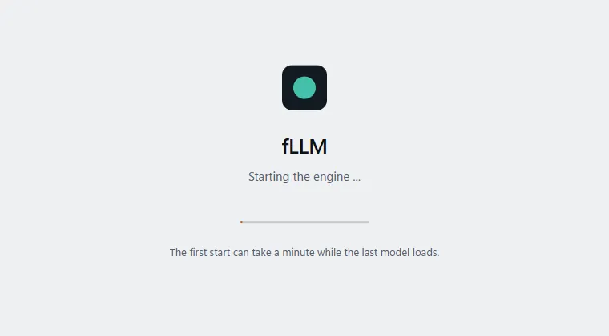
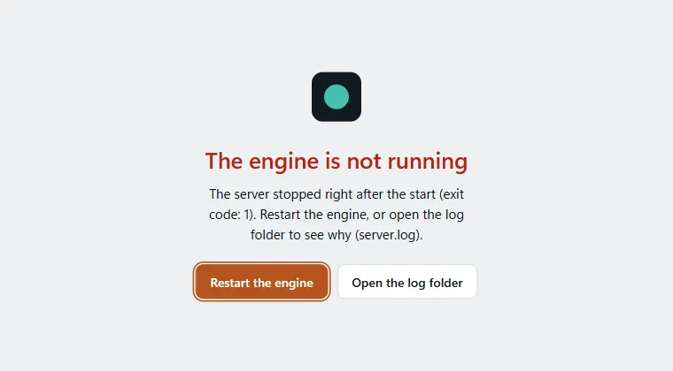

# Desktop app

The desktop app is the [Studio](studio.md) in its own window, with the server built in. Install it like any other program, start it
from the menu, and pick a model on the first start. No terminal is needed.

* **Windows:** run the setup (`.exe`) or the `.msi`.
* **Linux:** install the `.deb` or `.rpm`, or make the `.AppImage` executable and start it.
* **macOS:** the installer (`.dmg`, Apple silicon) is built by the `desktop` workflow and by the release workflow; it has not been run on a Mac yet and is not signed or notarized, so macOS asks you to confirm the first start (right click, Open).

The installers are attached to every [release](https://github.com/Marco-Lu2508/fLLM/releases); the `desktop` workflow builds them for every change (Actions, then the artifacts of a run). They are not signed yet, so
Windows may show a warning on the first start.

How it works: the app starts the `fllm-rs` program that is installed next to it (`fllm-rs studio` on a fixed local port, only reachable from
your computer) and shows its page. Closing the app stops the server. Models, chats and settings are kept between starts; the models are
stored in the usual fLLM model folder, shared with the command line.

## Server builds (variants)

The server program comes in builds for different graphics backends:

| Variant | Program | Backends | Where |
|---|---|---|---|
| CPU + Vulkan + DirectX (`base`) | `fllm-rs` | processor, Vulkan, DirectX 12 | every installer |
| CUDA + Vulkan (`cuda`) | `fllm-rs-cuda` | NVIDIA CUDA kernels (static CUDA runtime, only the NVIDIA driver is needed), Vulkan, processor | the `fLLM-cuda...` installers (Windows, Linux x86_64) |

Releases carry both kinds of installer. The `fLLM-cuda` one holds both programs and is larger: roughly the base installer plus the
CUDA archive of the release (the Linux one is about 360 MB with all architectures; the app build covers the NVIDIA RTX 20 series and
newer, sm_75 to sm_120, data centre GPUs included, with PTX for newer ones, so it is somewhat less). Pascal and Volta cards (GTX 10 series, V100)
are not in the app build: choose CPU + Vulkan for them, or use the `fllm-windows-x86_64-msvc-cuda.zip` or Linux CUDA archive of the release.

At every start the app picks the best installed variant whose hardware is present, with cheap checks that load no GPU software: the NVIDIA
driver library exists (`nvcuda.dll` in the Windows system folder; `libcuda.so.1` in the usual library folders or the loader cache on Linux)
and, on Linux, an NVIDIA display device is listed among the PCI devices. Otherwise the base variant runs.

* **Choose by hand:** Settings, Desktop app, "Graphics backends" (Automatic, CPU + Vulkan + DirectX, CUDA + Vulkan); it takes effect when the server restarts.
  The environment variable `FLLM_DESKTOP_VARIANT=<auto|cuda|base>` (also `cpu`, `vulkan`) beats the saved choice and is useful for a test.
* **Fallback:** if the chosen variant stops right after the start (driver missing or too old, a library error), the app starts the base
  variant instead, once. The loading page says so, and `server.log` in the log folder starts each run with a `[desktop]` line naming the variant (and the reason for a fallback).
* **Which one runs:** shown in the same settings section and under Settings, Hardware.

Build notes: `tauri.conf.json` lists only the base program, so a plain build needs nothing else. `tauri.cuda.conf.json` adds `fllm-rs-cuda`;
build with `cargo tauri build --config tauri.cuda.conf.json` after copying the CUDA build of `fllm-rs` to
`desktop/src-tauri/binaries/fllm-rs-cuda-<target triple>[.exe]`. A new variant (for example HIP) is one more entry in the table in
`desktop/src-tauri/src/variants.rs` plus its own config file and release job; the steps are written at the top of that file.

## Features

* **One window:** starting the app again brings the open window to the front instead of starting a second server.
* **Tray icon:** a menu with Open fLLM, Restart server, Open log folder and Quit. Left click on the icon opens the window.
* **Keep running in the tray:** off by default. When on, closing the window hides it and the server keeps running; use Quit in the tray menu to end the app.
* **Start fLLM when I sign in:** off by default. When it is on together with the tray option, the app starts hidden in the tray.
* **Quick entry hotkey:** a global hotkey (default Ctrl+Alt+Space) that works from any program: it brings the window to the front (also
  from the tray) and opens a new chat with the cursor in the message field. Change or switch it off in Settings, Desktop app: click the
  field and press the keys (Ctrl, Alt or Cmd is required). If another program already uses the combination the page says so and keeps
  the old hotkey. Some Linux desktops (Wayland) do not allow global hotkeys.
* **Window place:** size and position are remembered between starts.
* **If the server stops,** the window shows the loading page with the reason and two buttons, *Restart the engine* and *Open the log folder*
  (`server.log`); the tray menu has the same two entries. While the engine starts the page shows a quiet progress bar and, for a long model
  load, the seconds so far.
* **Links to other sites** (sources under an answer, links in a reply) open in your default browser; only `http`, `https` and `mailto`
  links are handed to the system. The window never leaves the Studio.
* **Light or dark:** the loading page and the Studio follow the system setting until you choose a theme.

The options are in the Studio under Settings, Desktop app (the section only exists inside the app). The same page has the buttons
Open log folder and Restart server.

Where things are kept: the options are in `settings.json` in the config folder of the app (Windows `%APPDATA%\io.github.marco-lu2508.fllm`,
Linux `~/.config/io.github.marco-lu2508.fllm`, macOS `~/Library/Application Support/io.github.marco-lu2508.fllm`); the page shows the exact folders. The start at sign-in is
registered with the system (a Run entry on Windows, an autostart `.desktop` file on Linux, a launch agent on macOS), and the window place is kept by the window-state plugin in the same config folder. On
Linux the tray icon needs an app-indicator extension on some desktops (for example GNOME).

Security: the page of the local server may call exactly seven commands of the app (read the options, set the tray option, set the
start at sign-in, set the quick entry hotkey, set the server variant, open the log folder, restart the server), and only when it is shown from `http://127.0.0.1` in the app window (a Tauri 2
remote capability, `desktop/src-tauri/capabilities/studio-page.json`). No file, shell or network access of the app is exposed.

The source is in `desktop/` (Tauri 2). To build it yourself, build `fllm-rs`, copy it to
`desktop/src-tauri/binaries/fllm-rs-<target triple>`, then run `cargo tauri icon ../app-icon.png` and `cargo tauri build` in
`desktop/src-tauri`.